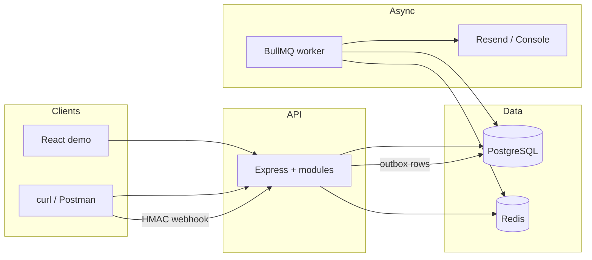

# OrderFlow

**Production-style e-commerce backend** — orders, inventory, signed payment webhooks, and reliable notifications.

Built as a portfolio project for software engineering / backend / full-stack roles. The focus is on patterns you would discuss in system-design and backend interviews: transactional checkout, concurrency-safe inventory, idempotency, webhook verification, and the outbox pattern.

> **Honest scope.** This is a complete local demo, not a multi-tenant SaaS storefront. Payments are simulated with HMAC-signed webhooks (no Stripe). Email uses Resend when configured; otherwise messages are logged to the console.

---

## Why this project

Most toy shops stop at CRUD. OrderFlow deliberately includes the hard parts:

| Problem | Approach in OrderFlow |
|---------|------------------------|
| Overselling under concurrent checkouts | Row locks + conditional `UPDATE … WHERE available >= n` |
| Double-submit / flaky clients | `Idempotency-Key` with unique DB constraint |
| Webhook retries | Unique provider event ID + signature + timestamp window |
| DB write vs “send email” coupling | Transactional outbox → BullMQ worker |
| Money bugs | Integer minor units (cents), never floats |
| Auth abuse | Argon2id, hashed refresh tokens, rotation, RBAC |

---

## Features

- **Auth** — register, login, JWT access tokens, refresh-token rotation & revocation
- **RBAC** — `CUSTOMER`, `STAFF`, `ADMIN` with reusable middleware
- **Catalog** — products with search, filters, pagination, soft archive, unique SKU
- **Inventory** — available / reserved / sold, restock, adjustment history
- **Cart** — one active cart; totals always recomputed from server prices
- **Checkout** — single DB transaction: lock stock → reserve → order + payment → outbox
- **Payments** — simulator webhooks (`payment.succeeded` / `failed` / `refunded`)
- **Notifications** — order/payment emails via worker (Resend or console)
- **API quality** — Zod validation, Helmet, CORS, rate limits, request IDs, Pino logs
- **Docs** — OpenAPI 3.1 + Swagger UI
- **Ops** — health/ready probes, optional Docker Compose, GitHub Actions CI
- **Tests** — unit, integration, and concurrency race tests

---

## Architecture



| Path | Role |
|------|------|
| `apps/api` | HTTP API + domain modules + worker entrypoint |
| `apps/web` | Small Vite + React demo (login → cart → checkout → pay) |
| `packages/shared` | Zod schemas, money helpers, shared constants |
| `prisma/` | Schema, migrations, seed data |
| `openapi/` | OpenAPI 3.1 source served at `/docs` |

---

## Tech stack

| Layer | Choice |
|-------|--------|
| Runtime | Node.js 20+ |
| Language | TypeScript (strict) |
| HTTP | Express |
| Database | PostgreSQL + Prisma |
| Queue | Redis + BullMQ |
| Validation | Zod |
| Passwords | Argon2id |
| Tokens | JWT access + refresh (refresh hashed at rest) |
| Logging | Pino |
| Tests | Vitest + Supertest |
| Docs | OpenAPI + swagger-ui-express |
| CI | GitHub Actions |

---

## Quick start (no Docker)

**Requirements:** Node.js 20+, PostgreSQL 14+, Redis 6+

```bash
git clone https://github.com/chaitanyasaxena01/orderflow.git
cd orderflow
cp .env.example .env
# Set DATABASE_URL, DIRECT_URL, REDIS_URL, and JWT / webhook secrets

npm install
npm run db:generate
npm run db:migrate
npm run db:seed

# Terminal 1 — API
npm run dev:api

# Terminal 2 — notification worker
npm run dev:worker

# Terminal 3 — optional UI
npm run dev:web
```

| URL | Purpose |
|-----|---------|
| http://localhost:4000/health | Liveness |
| http://localhost:4000/ready | Postgres + Redis readiness |
| http://localhost:4000/docs | Swagger UI |
| http://localhost:4000/openapi.json | OpenAPI document |
| http://localhost:5173 | Demo web app |

### Optional Docker

Docker is **not required**. If you prefer containers for Postgres/Redis (or the full stack):

```bash
docker compose up -d postgres redis   # infrastructure only
# or
docker compose up --build             # full stack
```

Secrets live in `.env` only — never in Dockerfiles.

---

## Demo accounts

After `npm run db:seed`, password for all accounts is **`Password123!`**

| Role | Email |
|------|--------|
| Admin | `admin@orderflow.dev` |
| Staff | `staff@orderflow.dev` |
| Customer | `customer@orderflow.dev` |
| Customer | `customer2@orderflow.dev` |

---

## API tour (curl)

```bash
# Login
TOKEN=$(curl -s -X POST http://localhost:4000/api/v1/auth/login \
  -H 'Content-Type: application/json' \
  -d '{"email":"customer@orderflow.dev","password":"Password123!"}' \
  | jq -r '.data.accessToken')

# List products
curl -s http://localhost:4000/api/v1/products | jq

# Add to cart
PRODUCT_ID=$(curl -s http://localhost:4000/api/v1/products | jq -r '.data[0].id')
curl -s -X POST http://localhost:4000/api/v1/cart/items \
  -H "Authorization: Bearer $TOKEN" \
  -H 'Content-Type: application/json' \
  -d "{\"productId\":\"$PRODUCT_ID\",\"quantity\":1}" | jq

# Checkout (Idempotency-Key required)
ORDER=$(curl -s -X POST http://localhost:4000/api/v1/checkout \
  -H "Authorization: Bearer $TOKEN" \
  -H 'Idempotency-Key: demo-1' \
  -H 'Content-Type: application/json' \
  -d '{}')
echo "$ORDER" | jq
ORDER_ID=$(echo "$ORDER" | jq -r '.data.id')
PAYMENT_ID=$(echo "$ORDER" | jq -r '.data.payment.id')

# Simulate signed payment webhook
export PAYMENT_WEBHOOK_SECRET   # from .env
npm run webhook:simulate -- \
  --paymentId "$PAYMENT_ID" \
  --orderId "$ORDER_ID" \
  --event payment.succeeded

# View order
curl -s "http://localhost:4000/api/v1/orders/$ORDER_ID" \
  -H "Authorization: Bearer $TOKEN" | jq
```

### Main endpoints

```text
POST   /api/v1/auth/register|login|refresh|logout
GET    /api/v1/auth/me

GET|POST|PATCH|DELETE  /api/v1/products...
GET|POST|PATCH         /api/v1/inventory...

GET|POST|PATCH|DELETE  /api/v1/cart...
POST                   /api/v1/checkout          # Idempotency-Key required
GET|POST               /api/v1/orders...

POST   /api/v1/webhooks/payments                 # HMAC signed
GET    /api/v1/admin/...                         # ADMIN
GET    /health  /ready  /docs
```

---

## Design deep-dives

### Checkout transaction

One database transaction:

1. Claim `Idempotency-Key` (unique per user + scope)
2. Load active cart
3. `SELECT … FOR UPDATE` inventory rows
4. Conditionally reserve stock
5. Create order + **immutable** order-item snapshots + pending payment
6. Write outbox event (`order.created`)
7. Mark cart checked out
8. Store response on the idempotency record

Any failure rolls inventory and order state back together.

### Inventory locking

```sql
UPDATE inventory
SET available_quantity = available_quantity - $quantity,
    reserved_quantity  = reserved_quantity + $quantity
WHERE product_id = $productId
  AND available_quantity >= $quantity;
```

Two clients racing for the last unit: only one update matches; the other gets `INSUFFICIENT_INVENTORY`.

### Idempotency

- Scope: user + `POST /api/v1/checkout`
- Same key + same body → original response
- Same key + different body → `409 IDEMPOTENCY_KEY_REUSED`
- Uniqueness enforced in PostgreSQL to survive concurrent requests

### Payment webhooks

Headers: `x-payment-signature`, `x-payment-timestamp`, `x-payment-event-id`

- Signature: `HMAC-SHA256(secret, timestamp + "." + rawBody)`
- Reject stale timestamps
- Dedupe on provider event ID
- `succeeded` → PAID + reserved→sold  
- `failed` → PAYMENT_FAILED + release reservation  
- `refunded` → REFUNDED + restock

### Background worker

API commits **outbox** rows in the same transaction as domain changes. The worker:

1. Claims `PENDING` outbox rows  
2. Enqueues BullMQ jobs (retries + exponential backoff)  
3. Sends email via Resend or console adapter  
4. Marks outbox `COMPLETED` / `FAILED`  
5. Shuts down cleanly on SIGTERM  

---

## Database models

`User`, `RefreshToken`, `Product`, `Inventory`, `InventoryAdjustment`, `Cart`, `CartItem`, `Order`, `OrderItem`, `Payment`, `PaymentWebhookEvent`, `IdempotencyKey`, `OutboxEvent`, `AuditLog`

- UUID primary keys  
- Money as integer cents  
- Unique email, SKU, inventory-per-product, webhook event ID, idempotency scope+key  

---

## Environment variables

Copy `.env.example` → `.env`. Required at startup (Zod-validated):

| Variable | Purpose |
|----------|---------|
| `DATABASE_URL` | PostgreSQL URL |
| `DIRECT_URL` | Direct URL for migrations (Neon) |
| `REDIS_URL` | Redis URL (`rediss://` for Upstash) |
| `JWT_ACCESS_SECRET` | ≥32 characters |
| `JWT_REFRESH_SECRET` | ≥32 characters |
| `PAYMENT_WEBHOOK_SECRET` | Webhook HMAC secret |
| `CORS_ORIGIN` | Browser origin(s) |
| `RESEND_API_KEY` | Optional; empty → console email |

Never commit `.env` or real secrets.

### Free hosted services (optional)

| Service | Use |
|---------|-----|
| [Neon](https://neon.tech) | Managed Postgres |
| [Upstash](https://upstash.com) | Managed Redis |
| [Resend](https://resend.com) | Transactional email |

---

## Scripts

```bash
npm run dev:api          # API with reload
npm run dev:worker       # notification worker
npm run dev:web          # React UI
npm run db:generate
npm run db:migrate
npm run db:seed
npm run test
npm run lint
npm run typecheck
npm run build
npm run webhook:simulate -- --paymentId <uuid> --orderId <uuid>
```

---

## Testing

```bash
npm run test                 # all
npm run test:unit            # pure unit tests
npm run test:integration     # HTTP + DB + concurrency
```

Coverage includes password hashing, JWT, HMAC, RBAC, checkout, idempotency, webhook dedupe, failed-payment inventory release, cross-customer isolation, and a **two-user race for the last inventory unit**.

CI (`.github/workflows/ci.yml`) runs install → Prisma generate → migrate → lint → typecheck → test → build with Postgres and Redis service containers.

---

## Security notes

- Argon2id password hashing; refresh tokens stored hashed and rotated
- Helmet, CORS from env, body size limits, Zod at the edge
- Secrets redacted from structured logs
- Webhook HMAC + timestamp window + event-id dedupe
- Production error responses do not leak internals
- Customers cannot read another user’s cart or order

---

## Known tradeoffs

- Single active cart per user; single-warehouse inventory
- Rate limiter is process-local unless you wire a Redis store
- Payment provider is a simulator by design
- Frontend is a workflow demo, not a full storefront
- Under extreme write contention you may still want client retries on rare conflict responses

---

## Possible next steps

- Stripe/Adyen adapter behind the same webhook interface  
- OpenTelemetry traces  
- Redis-backed distributed rate limiting  
- Staff fulfillment state machine (processing → shipped → completed)  
- Multi-warehouse inventory  

---

## License

MIT — free to use in portfolios, interviews, and learning.
